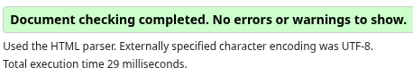
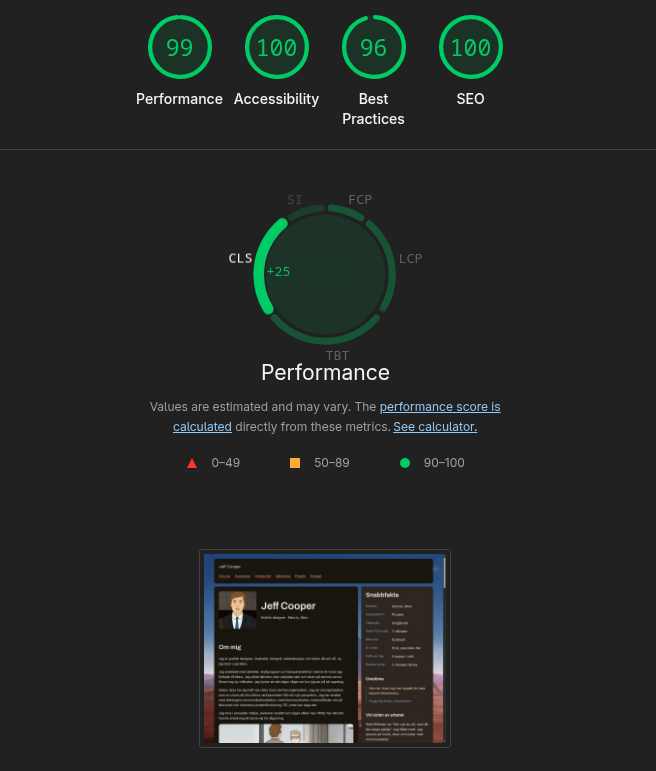
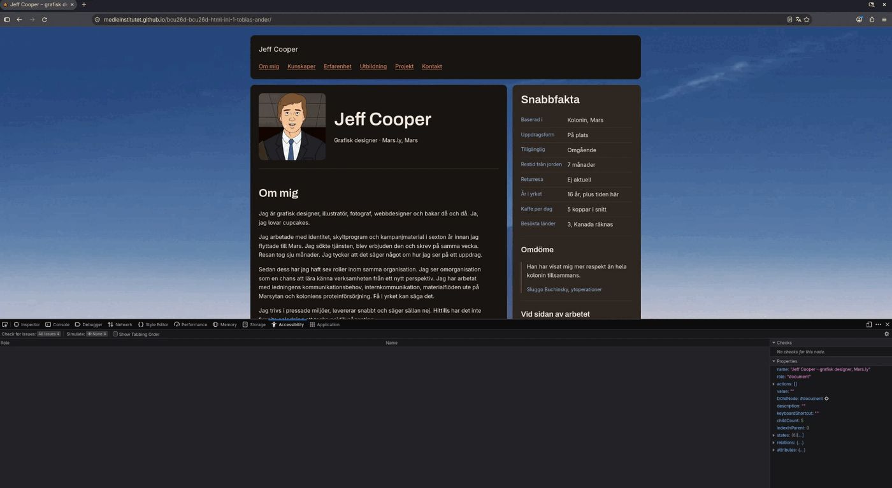

# Jeff Cooper — portfolio

Portfolio för Jeff Cooper, grafisk designer på Mars.ly i kolonin på Mars. Byggd som inlämningsuppgift i kursen HTML och CSS, BCU26D, på Medieinstitutet.

## Om projektet

Sidan är en ensidig portfolio i HTML och CSS, byggd ovanpå HTML5 Boilerplate v9.0.1.

Jeff Cooper är huvudpersonen i tv-serien _Fired on Mars_. Han sökte och fick tjänsten som grafisk designer hos Mars.ly, skrev på för en enkelresa, och hann arbeta i sju månader innan tjänsten lades på is. Han har sedan dess haft sex roller inom samma organisation. Portfolion samlar samtliga sex.

Uppgiften krävde en portfolio. Resten var en möjlighet i förklädnad.

## Granskningar

Sidan är granskad med tre verktyg. Full transparens: Best Practices stannade på 96.

| Verktyg                     | Resultat                                                      |
| --------------------------- | ------------------------------------------------------------- |
| W3C HTML Validator          | No errors or warnings to show                                 |
| Chrome Lighthouse           | Performance 99, Accessibility 100, Best Practices 96, SEO 100 |
| Firefox Accessibility Tools | Inga problem                                                  |

Skärmdumparna ligger i mappen `audits/`, sparade inför nästa steg.

| Fil                                | Innehåll                              |
| ---------------------------------- | ------------------------------------- |
| `audits/w3c-html-validator.png`    | Validatorns sammanfattning            |
| `audits/lighthouse.png`            | Lighthouse-rapportens fyra poäng      |
| `audits/firefox-accessibility.png` | Resultatet från fliken Tillgänglighet |

## Om tv-serien och upphovsrätten

Sidan bygger på tv-serien _Fired on Mars_, skapad av Nate Sherman och Nick Vokey.

Jeff Cooper är en fiktiv figur, liksom arbetsgivaren, kolonin och samtliga tjänster han haft där.

Bilderna är stillbilder ur serien. Upphovsrätten tillhör rättighetshavarna. De används här i utbildningssyfte inom en kurs, utan kommersiellt syfte, och projektet ger ingen intäkt till någon.

## Upphovsman

Tobias Ander, BCU26D, Medieinstitutet, 2026.
